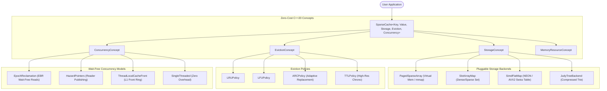

# Project Ginnunga

[](https://isocpp.org/)
[](https://www.gnu.org/licenses/agpl-3.0)
[]()

> **"In the beginning there was Ginnungagap, the primordial void, where the frost of Niflheim and the sparks of Muspelheim collided to ignite existence."**  
> — *The Prose Edda*

**Ginnunga** is a high-performance C++ Sparse Cache Algorithm Framework engineered for low-latency, mission-critical systems. It addresses environments where the addressable keyspace is massive and unpredictable, but active data is thinly distributed. Ginnunga bridges the gap between the $O(1)$ latency of dense arrays and the memory efficiency of hash maps, eliminating pointer chasing, avoiding false sharing, and keeping CPU cache lines hot.

---

## Architecture Overview



---

## Key Features

### 1. Static Polymorphism via C++20 Concepts
Every component is decoupled using C++20 Concepts (`StorageConcept`, `EvictionConcept`, `ConcurrencyConcept`, `MemoryResourceConcept`). Zero virtual dispatch overhead, enabling total compiler inlining and interprocedural optimization.

### 2. Pluggable Sparse Storage Backends
- **`PagedSparseArray`**: Reserves massive virtual address spaces using OS paging (`mmap`). Physical memory is committed on-demand upon access and dynamically reclaimed using `madvise(MADV_DONTNEED)`. Ideal for sparse integer keys (such as FIX Order IDs).
- **`SlotArrayMap` (Sparse Set)**: Utilizes two arrays: a sparse mapping array for $O(1)$ lookups and a tightly packed dense array for $O(1)$ cache-line-friendly linear iteration and swap-and-pop deletions.
- **`SimdFlatMap`**: Open-addressing flat hash table utilizing SIMD vector instructions (ARM NEON on Apple Silicon, AVX2 on x86_64) to inspect 16 control bytes simultaneously in a single CPU cycle.
- **`JudyTreeBackend`**: Highly compressed adaptive radix trie designed to minimize memory footprint across sparse integer keys without pointer chasing.

### 3. Advanced Replacement & Eviction Policies
- **`LRUPolicy`**: Least Recently Used recency tracking in $O(1)$ time.
- **`LFUPolicy`**: Least Frequently Used frequency bucketing in $O(1)$ time.
- **`ARCPolicy`**: Adaptive Replacement Cache dynamically self-tuning between recency and frequency using ghost caches ($B_1$, $B_2$).
- **`TTLPolicy`**: Time-to-Live policy evaluating monotonic clocks to expire stale keys lazily and proactively.

### 4. Wait-Free Concurrency & Memory Reclamation
- **`EpochReclamation` (EBR)**: Registered read epochs guarantee wait-free reads on cache hits while writers defer memory reclamation until readers progress.
- **`HazardPointers`**: Thread-level pointer publishing preventing writers from deallocating active nodes.
- **`ThreadLocalCacheFront`**: Thread-local ring-buffer front cache enabling local lookups with zero atomics and zero lock contention.
- **`SingleThreaded`**: Zero-cost policy for single-threaded or thread-isolated workloads.

### 5. Memory & Telemetry Subsystems
- **`NumaArenaResource`**: `std::pmr::memory_resource` compliant allocator pinning memory to specific NUMA sockets (or cache-line aligned arena on UMA).
- **`HugePageAllocator`**: Bypasses standard 4KB pages in favor of 2MB huge pages to eliminate TLB misses across massive address spaces.
- **`CacheLineVisualizer`**: Compile-time utility asserting and diagramming 64-byte L1 cache-line boundaries to prevent false sharing.
- **`MetaDumper`**: Zero-overhead JSON telemetry serializer introspecting operational stats and compile-time template parameters.

---

## Directory Structure

```
ginnunga/
├── CMakeLists.txt
├── README.md
├── include/ginnunga/
│   ├── cache.hpp                     # Master SparseCache orchestrator
│   ├── concepts/
│   │   ├── storage.hpp               # StorageConcept interface
│   │   ├── eviction.hpp              # EvictionConcept interface
│   │   ├── concurrency.hpp           # ConcurrencyConcept interface
│   │   └── memory.hpp                # MemoryResourceConcept interface
│   ├── memory/
│   │   ├── numa_arena_resource.hpp   # NUMA & aligned arena allocator
│   │   └── huge_page_allocator.hpp   # 2MB huge page mmap allocator
│   ├── storage/
│   │   ├── paged_sparse_array.hpp    # Virtual memory lazy-paged array
│   │   ├── slot_array_map.hpp        # Sparse set with packed dense array
│   │   ├── simd_flat_map.hpp         # NEON/AVX2 SIMD control-byte hash map
│   │   └── judy_tree_backend.hpp     # Compressed adaptive radix trie
│   ├── eviction/
│   │   ├── lru_policy.hpp            # LRU replacement
│   │   ├── lfu_policy.hpp            # LFU replacement
│   │   ├── arc_policy.hpp            # Adaptive Replacement Cache
│   │   └── ttl_policy.hpp            # Time-To-Live monotonic clock policy
│   ├── concurrency/
│   │   ├── epoch_reclamation.hpp     # Epoch-Based Reclamation (EBR)
│   │   ├── hazard_pointers.hpp       # Hazard pointer publishing
│   │   ├── thread_local_cache_front.hpp # Thread-local L1 ring buffer
│   │   └── single_threaded.hpp       # Zero-cost single-threaded policy
│   └── telemetry/
│       ├── meta_dumper.hpp           # Zero-cost JSON telemetry serializer
│       └── cache_line_visualizer.hpp # 64-byte cache line layout inspector
├── src/
│   └── ginnunga.cpp                  # Library runtime symbols
├── examples/
│   ├── fix_order_cache.cpp           # Exchange Connectivity (PagedSparseArray + TTL)
│   ├── ecs_component_cache.cpp       # Game Engine ECS (SlotArrayMap + LRU)
│   └── tcp_session_tracker.cpp       # IPv6 Session Tracking (SimdFlatMap + ARC + EBR)
├── tests/
│   ├── test_framework.hpp            # Lightweight test harness
│   ├── test_main.cpp                 # Test runner entry
│   ├── test_concepts.cpp             # Compile-time concept verification
│   ├── test_storage.cpp              # Storage backends unit tests
│   ├── test_eviction.cpp             # Eviction policies unit tests
│   ├── test_concurrency.cpp          # Concurrency models unit tests
│   └── test_cache.cpp                # Integrated SparseCache tests
└── bench/
    └── bench_cache.cpp               # High-throughput microbenchmarks
```

---

## Quick Start Example

```cpp
#include <iostream>
#include <ginnunga/cache.hpp>
#include <ginnunga/storage/simd_flat_map.hpp>
#include <ginnunga/eviction/arc_policy.hpp>
#include <ginnunga/concurrency/epoch_reclamation.hpp>

int main() {
    // Compose an ultra-low-latency cache with SIMD probing,
    // Adaptive Replacement Eviction, and Wait-Free EBR concurrency:
    using Cache = ginnunga::SparseCache<
        uint64_t,
        std::string,
        ginnunga::storage::SimdFlatMap<uint64_t, std::string>,
        ginnunga::eviction::ARCPolicy<uint64_t>,
        ginnunga::concurrency::EpochReclamation
    >;

    Cache cache(10000); // 10,000 capacity

    cache.put(42ULL, "OrderExecuted");
    
    if (auto val = cache.get(42ULL); val.has_value()) {
        std::cout << "Cached value: " << *val << "\n";
    }

    // Inspect live telemetry JSON
    std::cout << cache.dump_telemetry_json("ProductionCache") << "\n";
    return 0;
}
```

---

## Building and Testing

### Prerequisites
- Modern C++ compiler supporting C++20 or C++26 (Apple Clang 15+, Clang 16+, GCC 12+)
- CMake 3.22+

### Build
```bash
cmake -B build -DCMAKE_BUILD_TYPE=Release
cmake --build build -j
```

### Run Unit Tests
```bash
./build/ginnunga_tests
```

### Run Microbenchmarks
```bash
./build/ginnunga_bench
```

### Run Application Examples
```bash
# 1. Exchange Connectivity (FIX Order IDs with Virtual Memory Paging)
./build/example_fix_order

# 2. Game Engine ECS Component Cache (Sparse Sets with Cache-Line Density)
./build/example_ecs_component

# 3. Userspace IPv6 Session Tracker (SIMD Flat Map + ARC + EBR)
./build/example_tcp_session
```

---

## License
This project is licensed under the **GNU Affero General Public License v3.0 (AGPL-3.0)**. See the [LICENSE](file:///Users/zeeshanqazi/projects/Ginnunga/LICENSE) file for complete terms and conditions.

See [CREDITS.md](file:///Users/zeeshanqazi/projects/Ginnunga/CREDITS.md) for research citations, algorithmic inspirations, and acknowledgments.
